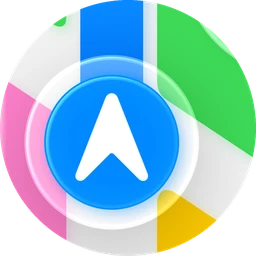

<div align="center"></div>

<h1 align="center">Apple Maps for Android</h1>

<p align="center">maps.apple.com, weird logo edition.</p>

## Features

- Opens maps.apple.com and `geo:` links from other apps
- Full screen
- Long-press a link to copy it

## Privacy

- Only maps.apple.com loads inside the app; website and phone links open in your browser or dialer
- Loads only from Apple's map servers; Apple's map analytics and third-party content blocked
- Cookies cleared each time the app starts
- Google Safe Browsing and WebView usage reports off
- Hardware memory tagging opted-in
- Reproducible builds

## Install

Android 13 or newer. Download the APK from [Releases](../../releases), or add to Obtainium.

Verify your download with an app verifier:

```
org.getflourish.maps
0C:01:4B:4A:53:E3:81:DC:19:9B:05:E7:22:62:75:DA:13:6C:4D:51:03:E4:99:A4:E5:A8:CF:68:95:86:7B:CF
```

## Build

Needs JDK 21, the Android SDK (platform 37, build-tools 37.0.0) and Gradle 9.5.1.

```sh
gradle assembleRelease
```

## License

All code is dedicated to the public domain under the [CC0 1.0](LICENSE). Apple Maps and its icon are trademarks of Apple Inc.; this project has nada to do with Apple, yada yada.
